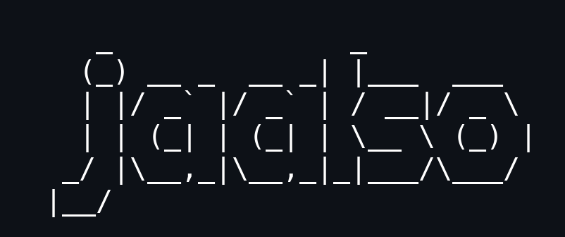

  

  <a href="https://github.com/jaalso/cybersecurity-portfolio">Portfolio</a> ·
  <a href="https://jaalso.github.io/labs">Lab Write-ups</a> ·
  <a href="https://www.linkedin.com/in/jasove">LinkedIn</a>

---

### Focus areas
| Area | What I work on |
|---|---|
| **Detection & SIEM** | Wazuh SIEM/XDR, CIS Benchmark auditing, email security gateway |
| **Incident response & DFIR** | KAPE triage, Eric Zimmerman tools, attack-chain reconstruction, Windows lateral movement |
| **Memory forensics** | Volatility 2/3, banking-trojan analysis (Cridex, Zeus/Zbot) |
| **Threat intelligence** | Phishing investigations, including Storm-1865, acknowledged by NCSC Switzerland |
| **Web & TLS security** | OWASP Top 10, certificate analysis, HSTS, Apache hardening |
| **Identity (IAM)** | Keycloak, OIDC Authorization Code flow, JWT analysis |
| **Offensive (for defence)** | Network pentesting, phishing simulation, WordPress exploitation labs |
| **Automation** | Python and PowerShell security tooling |

### Featured repositories
- [**blue-team-labs**](https://github.com/jaalso/blue-team-labs): Phishing PCAP forensics, Wazuh SIEM, mail gateway, Windows triage script
- [**incident-response-labs**](https://github.com/jaalso/incident-response-labs): SMB brute force, Windows forensics, DFIR engagements
- [**red-team-labs**](https://github.com/jaalso/red-team-labs): Pentesting, GoPhish, WordPress CVE labs
- [**security-research**](https://github.com/jaalso/security-research): Threat verification, privacy and regulatory analysis
- [**security-scripts**](https://github.com/jaalso/security-scripts): Python tooling for SOC triage, SBOM scanning and typosquatting detection

### Toolbox
`Wazuh` `Wireshark` `Volatility` `KAPE` `Burp Suite` `Metasploit` `nmap` `Keycloak` `Python` `PowerShell` `Bash` `Kali Linux` `Docker`

All work comes from isolated personal labs, authorised targets and training platforms (HTB, THM, PortSwigger, CyberDefenders). It is not commercial pentest work.

gbf-proof-tIOKWZj11L2pauEUIn0mZPCBMlKnmEfj
